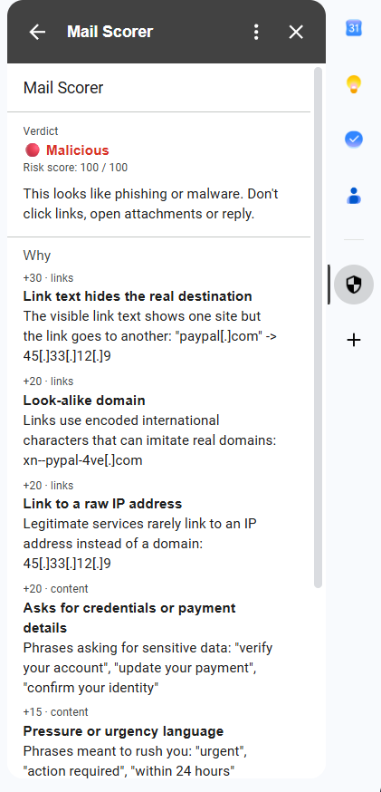
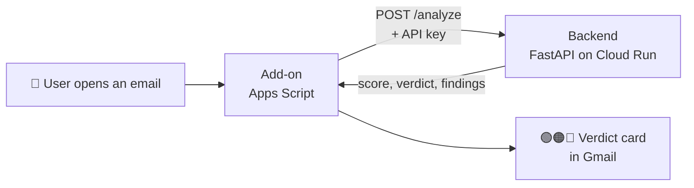

# 🛡️ Mail Scorer

**A Gmail add-on that tells you, in plain words, how dangerous an email looks, and why.**

Open an email, and a panel on the right side of Gmail shows a verdict, a risk score from 0 to 100, and the exact reasons behind it:

> 🔴 **Malicious**, risk score 100 / 100
>
> **+40** Disguised executable attachment: "invoice.pdf.exe" is actually a .exe program
> **+30** Possible PayPal impersonation: "PayPal Security" sent from "paypa1-secure[.]ru"
> **+30** Link text hides the real destination: "paypal[.]com" → 45[.]33[.]12[.]9

No black box: every point in the score comes from a finding you can read.

<p align="center"></p>

---

## How it works



- **Add-on** ([`addon/`](addon)): reads the open email, sends it to the backend, and renders the result. A thin client: it never decides anything itself.
- **Backend** ([`backend/`](backend)): Python + FastAPI on Google Cloud Run. All the detection logic lives here, so rules can change without redeploying the add-on. Each check is a separate module in [`backend/app/checks/`](backend/app/checks).

## What it checks

Phishing almost always relies on at least one of five moves: **forging the sender**, **impersonating a brand**, **a deceptive link**, **pressure to act fast**, or **a malicious attachment**. Each check targets one of them, so together they cover the attack paths seen most often, using only data already in the email.

| Check | Looks for |
|---|---|
| 🔐 **Authentication** | SPF / DKIM / DMARC failures |
| 🎭 **Sender** | Brand names from foreign domains (`PayPal <x@evil.ru>`), fake addresses in the display name, a mismatched `Reply-To` |
| 🔗 **Links** | Link text that hides the real destination, raw IPs, look-alike (punycode) domains, `javascript:` links, shorteners |
| 💬 **Content** | Urgency and requests for credentials, in English and Hebrew |
| 📎 **Attachments** | Executables, fake double extensions (`invoice.pdf.exe`), hidden right-to-left characters, macro-enabled Office files |

**Scoring:** each finding adds points by severity, capped at 100. **0–29** 🟢 Safe · **30–69** 🟠 Suspicious · **70+** 🔴 Malicious.

I chose rules over a model on purpose: the score is explainable, deterministic and testable.

## Security

Emails, attachments and API responses are all treated as untrusted:

- **Nothing is opened.** Links are never fetched (no SSRF, and the attacker isn't tipped off), and attachments are judged by file name only.
- **Output is escaped and defanged.** Gmail cards render HTML. Testing showed `Name <a@b.com>` displayed as just `Name`, so every email-derived string is escaped, and domains appear as `evil[.]com`.
- **Only Gmail's own auth header is trusted.** A sender can forge `Authentication-Results` headers, so only the one from `mx.google.com` counts.
- **Strict input limits** on every field, and unknown fields are rejected. The add-on also validates the backend's response before display.
- **Secrets stay out of the code.** The API key lives in Script Properties and Secret Manager. The backend won't start without one, and keys are compared in constant time.
- **Least privilege.** The add-on reads only the open message, can call only the backend's URL (`urlFetchWhitelist`), and the container runs as non-root.
- **Privacy.** Email content is never stored or logged.

## Running it

**Backend (local)**
```bash
cd backend
python -m venv .venv && .venv/Scripts/python -m pip install -r requirements-dev.txt
cp .env.example .env                                   # set API_KEY
.venv/Scripts/python -m pytest                         # 16 tests
.venv/Scripts/python -m uvicorn app.main:app --reload  # http://127.0.0.1:8000/docs
```

**Backend (Cloud Run).** Store the key in Secret Manager as `mail-scorer-api-key`, then:
```bash
cd backend
gcloud run deploy mail-scorer --source . --region me-west1 --allow-unauthenticated \
  --set-secrets API_KEY=mail-scorer-api-key:latest --set-env-vars ENABLE_DOCS=false --max-instances 2
```

**Add-on.** Copy the files from `addon/` into a new [script.google.com](https://script.google.com) project. Set `BACKEND_URL` in `Config.js`, and add `API_KEY` under **Project Settings → Script Properties**. Then **Deploy → Test deployments → Install**.

## Scope decisions

Choices I made deliberately for this assignment, and what a production version would use:

| Decision | Why, for this scope | In production |
|---|---|---|
| **Static shared API key** | Simple, keeps the endpoint private, and the key never reaches the browser | Per-user Google-signed ID tokens, verified by the backend |
| **Built-in lists** (brands, phrases, domain suffixes) | Offline, fast and fully testable, with no third-party dependencies | Threat-intel feeds and the full Public Suffix List |
| **Static analysis only**: links never fetched, attachments judged by name | Zero risk of SSRF, exploits, or tipping off the attacker | Sandboxed URL and file detonation, with reputation lookups (Safe Browsing, VirusTotal) |
| **Rules instead of ML** | Every point is explainable and every rule is unit-tested | Rules + an ML/LLM signal for reworded phishing |
| **Manual add-on deploy** (no clasp) | Fewer tools for a single-developer project | clasp in CI with versioned deployments |
